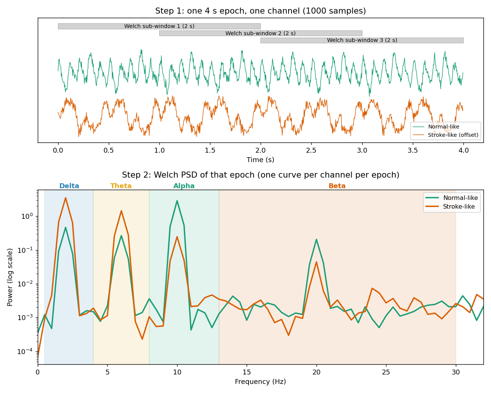
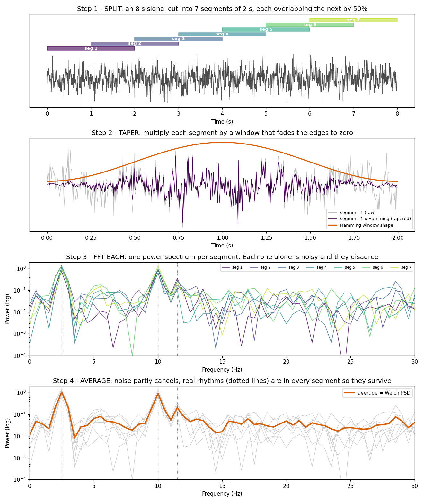
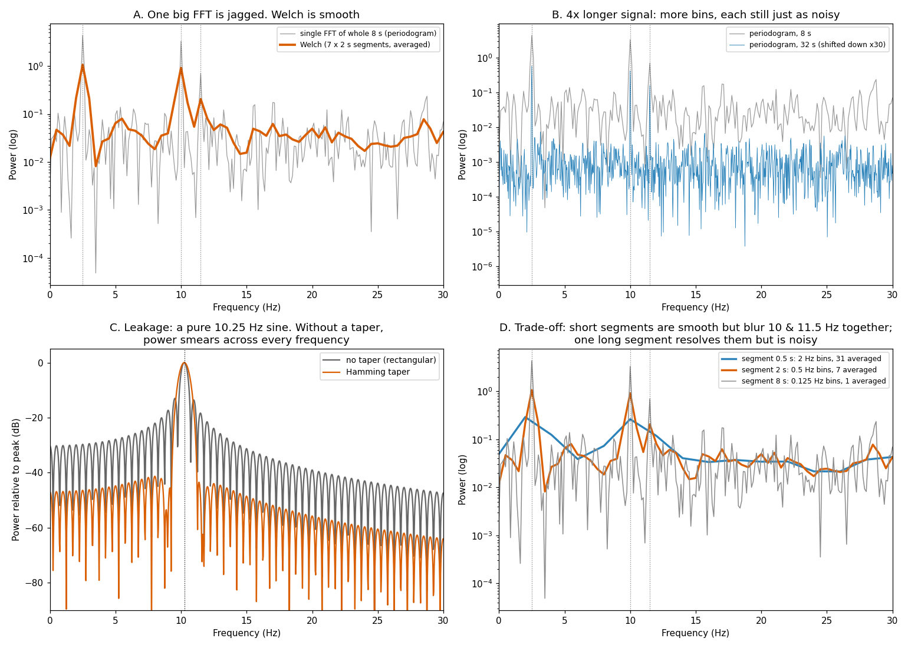

# Visualizations

## PSD (Power Spectral Density)



*Synthetic signals, made with [psd_demo.py](psd_demo.py). Settings match Tamim's pipeline: 250 Hz, 4 s epoch, Welch with 2 s Hamming sub-windows at 50% overlap.*

- **Top:** one 4 s epoch from one channel (1,000 samples). The grey bars are Welch's sub-windows. Each one gets an FFT, then the three spectra are averaged.
- **Bottom:** the PSD that comes out, i.e. how much power the epoch has at each frequency.
  - **Normal-like:** big alpha peak at 10 Hz.
  - **Stroke-like:** "slowing", with delta and theta up and alpha and beta down.

### Epoch basis, not sample basis

A PSD is computed **per epoch, per channel**:

```
1 subject ─► continuous signal (16 channels)
                │  sliding window (duration, overlap)
                ▼
          epoch 1, epoch 2, ... epoch N
                │  for each epoch, for each of the 16 channels:
                ▼
          1 PSD curve  ◄── built from ALL the samples in that epoch (e.g. 1000)
                │  sum power inside each band
                ▼
          4 band powers (δ, θ, α, β) per channel  →  16 × 4 = 64 PSD features per epoch
```

- **A single sample has no PSD.** A sample is one voltage value at one instant. Frequency only exists across many samples in time.
- **Each epoch gives 16 PSDs**, one per channel.
- **Epoch length controls PSD quality.** Longer epochs fit bigger Welch sub-windows, which gives finer frequency resolution. 1 s epochs get 2 Hz bins, and 4 s or longer get 0.5 Hz bins (Tamim Fig 4.5).

### Band powers from the plot above

| | Delta | Theta | Alpha | Beta | Delta/Alpha ratio |
|---|---|---|---|---|---|
| Normal-like | 0.64 | 0.39 | **3.92** | 0.34 | 0.16 |
| Stroke-like | **4.84** | 2.00 | 0.36 | 0.13 | **13.48** |

These band powers are the **spectral features**. The ratio column is a **band-ratio feature**. Comparing the same band on left and right electrodes, e.g. C3 vs C4, would give an **asymmetry feature**.

---

## Welch's method

*Made with [welch_demo.py](welch_demo.py). Synthetic 8 s signal at 250 Hz with three real rhythms (2.5 Hz delta, 10 Hz alpha and a weaker 11.5 Hz rhythm, shown as dotted lines) buried in noise. Segment length is 2 s, the same as Tamim's `nperseg = 500`.*

**In one line:** to get a clean PSD, average many FFTs instead of trusting one.

### The four steps



1. **Split** the signal into short segments that overlap by 50%. 8 s with 2 s segments gives 7 of them.
2. **Taper** each segment by multiplying it by a Hamming window (orange curve) that fades the edges to zero.
3. **FFT each segment** and square the magnitude to get power. Each spectrum is noisy on its own, and the 7 of them disagree.
4. **Average** the 7 spectra. The random noise partly cancels out. The real rhythms show up in every segment, so they survive.

### Why bother?



| Panel | Shows |
|---|---|
| **A** | One FFT of the whole 8 s (grey) is jagged, with noise spikes as tall as real peaks. Welch (orange) is smooth, and the 3 real peaks stand out. |
| **B** | Using a 4× longer signal **doesn't fix it**. A single FFT just gives more frequency bins, and each one is still as noisy. Only averaging reduces the noise. |
| **C** | **Spectral leakage.** A pure 10.25 Hz sine should be one spike. Without a taper (grey), cutting the signal off sharply at the edges spreads power across every frequency, with sidelobes only about 15–30 dB down. Hamming (orange) pushes them down to about 45 dB below the peak. The cost is a slightly wider main peak. |
| **D** | **The segment-length trade-off.** |

Panel D in detail:

| Segment | Bin width (1 / length) | Segments averaged | Result |
|---|---|---|---|
| 0.5 s (blue) | 2 Hz | 31 | Smooth, but 10 and 11.5 Hz blur into one bump |
| 2 s (orange, Tamim's choice) | 0.5 Hz | 7 | Smooth enough, and 10 and 11.5 Hz are separate |
| 8 s (grey, one segment) | 0.125 Hz | 1 | Sharpest peaks, but as noisy as a single FFT |

### Link to Tamim

- Tamim uses Welch with a Hamming window, 50% sub-window overlap and segments of up to 2 s.
- For short epochs the segment is capped at half the epoch, so there are at least 2 to average. For 1 s epochs that means 0.5 s segments and 2 Hz bins, which is the blurry blue line in panel D (Tamim's Fig 4.5).
- The Welch sub-window overlap is **not** the same as Tamim's epoch overlap. Welch overlap happens inside one epoch. Epoch overlap is between epochs.
